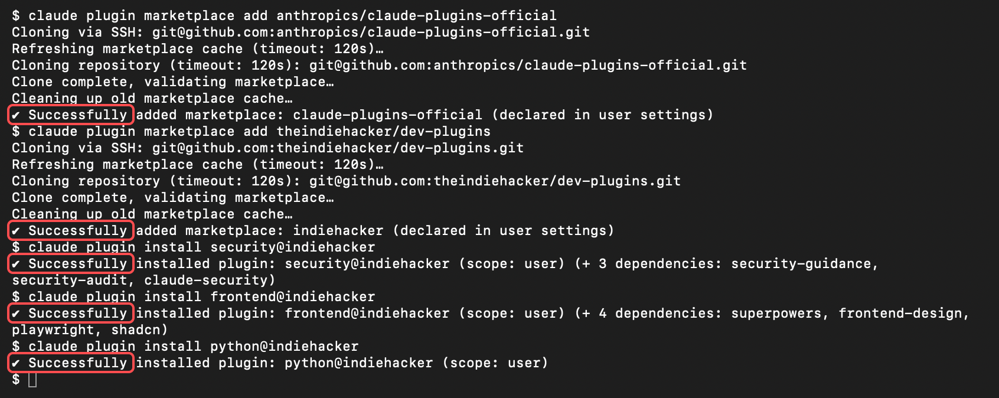

# 🔌 dev-plugins

<p align="center">
  
</p>

<p align="center">
  <a href="https://code.claude.com/docs/en/discover-plugins"></a>
  <a href="plugins/frontend"></a>
  <a href="plugins/python"></a>
  <a href="plugins/cloud"></a>
  <a href="plugins/security"></a>
  <a href="renovate.json"></a>
</p>

<p align="center">
  
</p>

<p align="center">
  
</p>

## 🧩 プラグインの追加

<p align="center">
  
</p>

<details><summary><b>☁️ Claude Code on the Web</b></summary>

**1. 環境のメニューを開く**

[claude.ai/code](https://claude.ai/code) を開き、入力欄の下の雲のマーク (①) を押してから、「新しい環境」(②) を押します。


**2. 環境の名前を入れる**

「名前」(①) に、好きな名前を入れます。


**3. ネットワークアクセスを設定する**

手順 2 の画面の「ネットワークアクセス」(②) を押して、次のように設定します。

- ① 「制限付き」を選びます。
- ② 「許可されたドメイン」に、次の内容をコピーして貼り付けます。

  ```
  semgrep.dev
  pkg-containers.githubusercontent.com
  dl.google.com
  dl-cdn.alpinelinux.org
  ui.shadcn.com
  cdn.playwright.dev
  ```

- ③ 「[パッケージマネージャー](https://code.claude.com/docs/en/cloud-environments#default-allowed-domains)を許可」にチェックを入れます。
- ④ 「<」を押して、前の画面に戻ります。


**4. セットアップスクリプトを設定する**

手順 2 の画面の「セットアップスクリプト」(③) を押して、次のように設定します。

- ① 次の内容をコピーして貼り付けます。

  ```bash
  claude plugin marketplace add anthropics/claude-plugins-official
  claude plugin marketplace add theindiehacker/dev-plugins
  claude plugin install cloud@indiehacker
  claude plugin install security@indiehacker
  claude plugin install frontend@indiehacker
  claude plugin install python@indiehacker

  # 2026-11-08
  ```

- ② 「<」を押して、前の画面に戻ります。


**5. 環境を追加する**

手順 2 の画面の「環境を追加」(④) を押します。新しいセッションで、この環境が使われます。

**プラグインを更新したとき**

> [!WARNING]
> プラグインを更新したら、「セットアップスクリプト」の最後の行の日付を、更新した日に書き換えてください。書き換えないと、古いプラグインのまま動くことがあります。

作った環境は、手順 1 のメニューで環境の行にマウスを乗せ、歯車のマーク (①) を押すと開けます。書き換えたら保存してください。


</details>

<details><summary><b>💻 PC の Claude Code</b></summary>

**1. ターミナルを開く**

Mac では、`⌘` + `スペース` を押して「ターミナル」と入力し、`return` を押します。

**2. コマンドを実行する**

次のコマンドをコピーしてターミナルに貼り付け、`return` を押します。`marketplace add` が要るのは最初の 1 回だけです。

```bash
claude plugin marketplace add anthropics/claude-plugins-official
claude plugin marketplace add theindiehacker/dev-plugins

claude plugin install security@indiehacker
claude plugin install frontend@indiehacker
claude plugin install python@indiehacker
```

**3. 結果を確かめる**

赤枠のように `✔` が 5 つ出れば成功です。



**4. Claude Code を起動し直す**

Claude Code を開いていたら、起動し直します。

> [!NOTE]
> - `cloud` は Claude Code on the Web のセッションを準備するプラグインなので、PC には入れません。
> - `security` のコミット・push 前の検査には、Semgrep・Gitleaks・Trivy が要ります。Mac では `brew install semgrep gitleaks trivy` で入れられます。

</details>
