<p align="center">
  
</p>

<p align="center">
  <a href="https://code.claude.com/docs/en/discover-plugins"></a>
  <a href=".claude-plugin/plugin.json"></a>
  <a href="renovate.json"></a>
</p>

## 📱 あなたがするのは、これだけ

どれも、スマホの GitHub でできます。

1. Issue を書いて、ラベル `autopilot:ready` を付ける
2. 大事なファイルを変える PR だけ、Approve する
3. 止まったら、Issue で答える (止まったことは、Slack に届けられます)

## ☁️ そのあいだ、クラウドの Claude がすること

<p align="center">
  
</p>

<p align="center"><sub>※ 画面はイメージです</sub></p>

受入条件を決め、テストを書いてから実装し、アプリを動かして確かめます。レビューの指摘を直し、必須のチェックとレビューがそろったら、自動でマージします。

## 🛡️ 任せても壊れにくい

- **テストが先:** 受入条件を Issue に書き、それを確かめるテストを書いてから実装します
- **3 回の検査:** 作業の終わり・commit 前・push 前に、lint・型・シークレット・脆弱性を検査します
- **そろうまでマージしない:** 必須のチェックとレビューを待ちます。大事なファイルを変える PR は、あなたの Approve が要ります

## 🚀 はじめかた

### 1. プラグインを入れる

<details><summary><b>☁️ Claude Code on the Web の環境を作る</b></summary>

1. [claude.ai/code](https://claude.ai/code) を開き、入力欄の下の雲のマークを押してから、「新しい環境」を押します。
2. 「名前」に、好きな名前を入れます。
3. 「ネットワークアクセス」を押して「フル」を選び、「<」で戻ります。通信先を絞りたいときは、[制限付きにする手順](docs/network.md)を見てください。
4. 「セットアップスクリプト」を押して次の内容を貼り付け、「<」で戻ります。

   ```bash
   claude plugin marketplace add anthropics/claude-plugins-official
   claude plugin marketplace add theindiehacker/autopilot-plugin
   claude plugin install autopilot@indiehacker

   # 2026-11-11
   ```

5. 「環境を追加」を押します。新しいセッションで、この環境が使われます。

> [!WARNING]
> プラグインを更新したら、「セットアップスクリプト」の最後の行の日付を、更新した日に書き換えてください。書き換えないと、古いプラグインのまま動くことがあります。作った環境は、雲のマークのメニューで、環境の行の歯車のマークから開けます。

</details>

<details><summary><b>💻 PC の Claude Code に入れる</b></summary>

ターミナルで次を実行し、Claude Code を開いていたら起動し直します。`marketplace add` が要るのは最初の 1 回だけです。

```bash
claude plugin marketplace add anthropics/claude-plugins-official
claude plugin marketplace add theindiehacker/autopilot-plugin

claude plugin install autopilot@indiehacker
```

> [!NOTE]
> - Web 用の処理 (`dockerd`・`mise install`・`lefthook install`・`docker compose up`・Gitleaks などの導入・Claude に渡す指示のうち下書きの 2 つ) は、PC では動きません。
> - 検査には、Semgrep・Gitleaks・Trivy が要ります。Mac では `brew install semgrep gitleaks trivy` で入れられます。
> - git の hook は、PC では自動で入りません。setup を動かしていない clone では、`lefthook install` を行ってください。

</details>

### 2. PC の Claude Code で `/autopilot:setup` を実行する

PC を使うのは、この 1 回だけです。setup が、リポジトリを調べて、聞いて、提案し、同意を得てから整えて、PR を作ります。PR をマージすると、続けてルールセットとルーティンを作ります。

クラウドのセッションでは動きません (GitHub の設定を変える API が拒否されるため)。中身は [setup の手順](docs/setup.md)を見てください。

### 3. スマホで、Issue にラベルを付ける

権限のある人 (triage 以上) が `autopilot:ready` を付けると、Claude のルーティンが動き出し、マージまで進みます。進めないときは、`needs-human` を付けて止まります ([再開のしかた](docs/autopilot.md#止まる条件と再開のしかた))。

## ⚠️ 注意

- 受入条件の確かめ (QA) は、ルーティンが PR の本文に書く動作確認だけです。別の Claude は確かめ直しません。
- 必須にできる CI が無いリポジトリでは、Claude のレビューの承認だけで自動マージされます。
- 公開リポジトリでは、だれのコメントも、ルーティンのセッションに入ります。自動化専用の GitHub アカウントを勧めます。
- Terraform の apply がマージで動くリポジトリでは、Approve の後に、取り消せない操作が自動で走ります。
- 検査で見つけられない脆弱性もあります。

## 📚 詳しく

| ドキュメント | 中身 |
|---|---|
| [autopilot](docs/autopilot.md) | 流れ・ラベル・止まる条件と再開・setup の後にすること・Project・デプロイ |
| [setup の手順](docs/setup.md) | `/autopilot:setup` の 8 つの手順と、その順番の理由 |
| [自動で動くもの](docs/automation.md) | 起動時の処理・検査・技術スタックの方針・Claude に渡す指示・一緒に入るプラグイン |
| [ネットワークアクセスを制限付きにする](docs/network.md) | 通信先を絞りたいときの、Web の環境の設定 |
