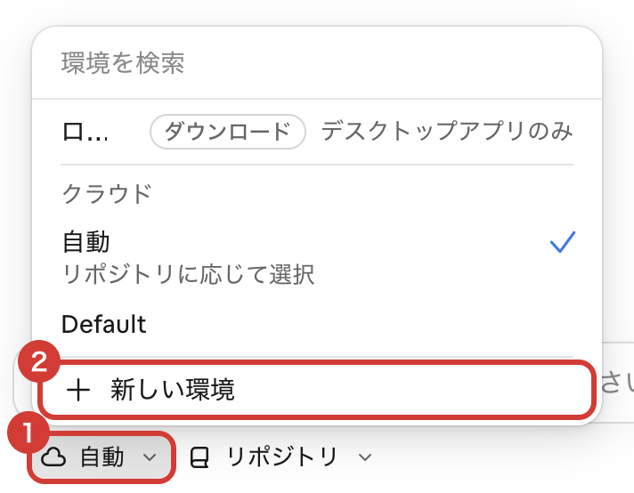
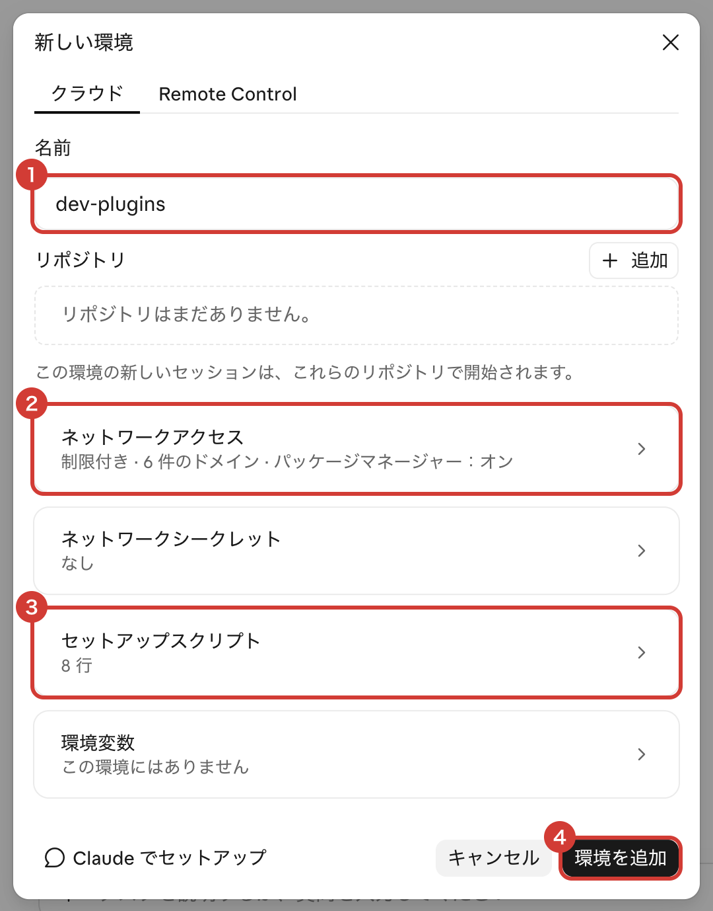
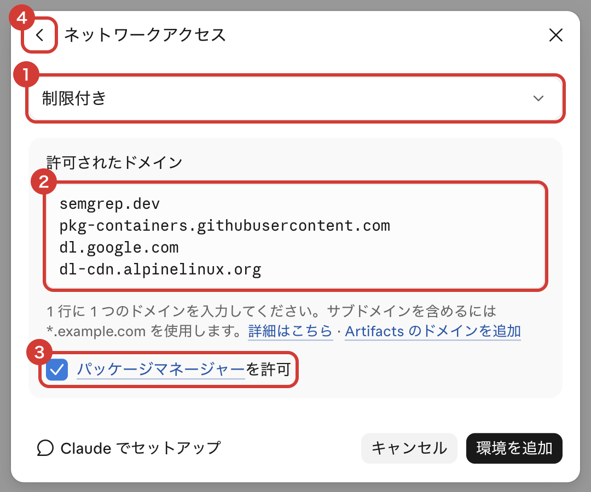
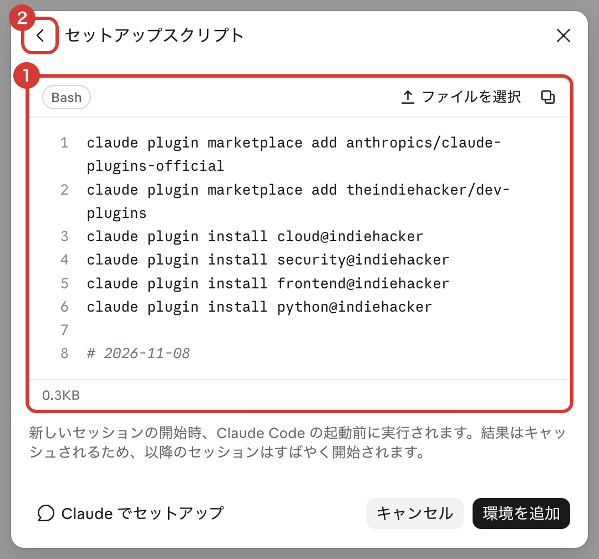
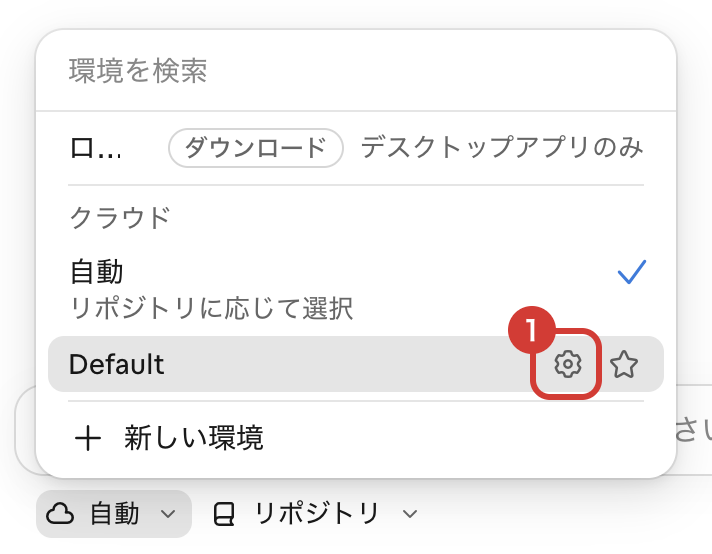

<p align="center">
  
</p>

<p align="center">
  <a href="https://code.claude.com/docs/en/discover-plugins"></a>
  <a href=".claude-plugin/plugin.json"></a>
  <a href="renovate.json"></a>
</p>

<p align="center"><b>Claude Code に、Claude Code on the Web のセッションの準備、技術スタックの統一、hooks による自動チェック (lint・型検査・シークレット検出・脆弱性スキャン) を追加するプラグインです。</b></p>

## ✨ 入れるとどう変わる？

<p align="center">
  
</p>

<p align="center"><sub>※ 出力はイメージです</sub></p>

## ⚙️ 自動で動くもの

| タイミング | 処理 | 動く条件 |
|---|---|---|
| 起動時 | `dockerd --registry-mirror=https://mirror.gcr.io` | Web のみ |
| 起動時 | `mise install` | Web で、`mise.toml` がある |
| 起動時 | `docker compose up --build -d --wait` (プロキシの CA をビルドと起動後のコンテナに渡す) | Web で、compose ファイルがある |
| 起動時 | `packageManager` の版の bun を用意し、`bun install --frozen-lockfile` | `bun.lock` がある |
| 起動時 | uv が無ければ導入し、Ruff・ty を導入 | `pyproject.toml`・`requirements*.txt`・`setup.py` がある |
| 起動時 | `uv sync --locked` | `uv.lock` がある |
| 起動時 | Gitleaks・Semgrep・Trivy を導入 | Web のみ。ローカルは無ければ警告だけ |
| 起動時 | 下の「技術スタックの方針」を Claude に伝える | フロントエンドは `package.json`、Python は `pyproject.toml`・`requirements*.txt`・`setup.py` がある |
| 起動時・再開時・要約の後 | 下の「Claude に渡す指示」を渡す | Web のみ |

- **検査:** 編集後・commit 前・push 前の検査は、プラグインの hook ではありません。`/autopilot:setup` が、リポジトリの `lefthook.yml` (commit 前・push 前) と `.claude/settings.json` (編集後) に入れます。人がターミナルで commit・push したときにも動きます。Web では、起動時に `lefthook install` を行います (`pre-commit` を使うリポジトリでは `pre-commit install`)。
- **LSP:** Claude が TypeScript と ty の LSP を使えます。
- **ローカルでの準備:** Gitleaks・Semgrep・Trivy は、Mac では `brew install semgrep gitleaks trivy` で入れられます。無いと、commit・push 前の検査が失敗します。

### 📐 技術スタックの方針

**フロントエンド**

- パッケージの管理と実行は bun。npm・npx・yarn・pnpm は使わない
- lint と整形は Biome。ESLint・Prettier は使わない
- UI は shadcn/ui のコンポーネントを使う。無いものだけ、shadcn/ui を組み合わせて作る
- スタイルは Tailwind CSS のクラスとテーマの変数で書く。`style` 属性・色コード・Tailwind の任意値は書かない
- 画面を足す・変えるときは、Playwright で E2E テストを書く

**Python**

- パッケージの管理と実行は uv。pip・poetry・pipenv は使わない
- lint と整形は Ruff。flake8・black・isort・pylint は使わない
- 型の検査は ty。mypy・pyright は使わない
- 依存の過不足は deptry、import の向きは import-linter で検査する
- 機能を足す・変えるときは、pytest でテストを書く

### 📝 Claude に渡す指示 (Web のみ)

- 自分の作った PR を `claude[bot]` のレビューが下書きに戻したときは、指摘を直す (または返信する) push をして CI が通ったら、ユーザーに聞かずに「レビュー可能」に戻してよい
- ほかの人が下書きに戻した PR は戻さない

Claude は、自分以外が下書きに戻した PR を、ユーザーに頼まれない限り「レビュー可能」に戻しません。この指示で、bot が戻した場合だけ Claude が戻せるようにします。

## 🎁 一緒に入るプラグイン

| プラグイン | 内容 |
|---|---|
| superpowers | 設計・実装計画・TDD・サブエージェント開発 |
| frontend-design | UI の見た目とタイポグラフィの方針 |
| playwright | ブラウザ操作と E2E テストの MCP サーバー |
| shadcn | shadcn/ui コンポーネントの追加・検索・修正 |
| security-guidance | 編集時の警告と diff・commit のレビュー |
| security-audit | Cloudflare のセキュリティ監査スキル |
| claude-security | 脆弱性スキャンと修正パッチの提案 |

## 📥 入れ方

<details><summary><b>☁️ Claude Code on the Web</b></summary>

**1. 環境のメニューを開く**

[claude.ai/code](https://claude.ai/code) を開き、入力欄の下の雲のマーク (①) を押してから、「新しい環境」(②) を押します。



**2. 環境の名前を入れる**

「名前」(①) に、好きな名前を入れます。



**3. ネットワークアクセスを設定する**

手順 2 の画面の「ネットワークアクセス」(②) を押して、次のように設定します。

- ① 「制限付き」を選びます。
- ② 「許可されたドメイン」に、次の内容をコピーして貼り付けます。

  ```
  semgrep.dev
  pkg-containers.githubusercontent.com
  dl.google.com
  dl-cdn.alpinelinux.org
  ui.shadcn.com
  cdn.playwright.dev
  ```

- ③ 「[パッケージマネージャー](https://code.claude.com/docs/en/cloud-environments#default-allowed-domains)を許可」にチェックを入れます。
- ④ 「<」を押して、前の画面に戻ります。



**4. セットアップスクリプトを設定する**

手順 2 の画面の「セットアップスクリプト」(③) を押して、次のように設定します。

- ① 次の内容をコピーして貼り付けます。

  ```bash
  claude plugin marketplace add anthropics/claude-plugins-official
  claude plugin marketplace add theindiehacker/autopilot-plugin
  claude plugin install autopilot@indiehacker

  # 2026-11-11
  ```

- ② 「<」を押して、前の画面に戻ります。



**5. 環境を追加する**

手順 2 の画面の「環境を追加」(④) を押します。新しいセッションで、この環境が使われます。

**プラグインを更新したとき**

> [!WARNING]
> プラグインを更新したら、「セットアップスクリプト」の最後の行の日付を、更新した日に書き換えてください。書き換えないと、古いプラグインのまま動くことがあります。

作った環境は、手順 1 のメニューで環境の行にマウスを乗せ、歯車のマーク (①) を押すと開けます。書き換えたら保存してください。



</details>

<details><summary><b>💻 PC の Claude Code</b></summary>

**1. ターミナルを開く**

Mac では、`⌘` + `スペース` を押して「ターミナル」と入力し、`return` を押します。

**2. コマンドを実行する**

次のコマンドをコピーしてターミナルに貼り付け、`return` を押します。`marketplace add` が要るのは最初の 1 回だけです。

```bash
claude plugin marketplace add anthropics/claude-plugins-official
claude plugin marketplace add theindiehacker/autopilot-plugin

claude plugin install autopilot@indiehacker
```

**3. 結果を確かめる**

`✔ Successfully` が 3 つ出れば成功です。

**4. Claude Code を起動し直す**

Claude Code を開いていたら、起動し直します。

> [!NOTE]
> - Web 用の処理 (`dockerd`・`mise install`・`docker compose up`・Claude に渡す指示) は、PC では動きません。
> - lefthook の検査には、Semgrep・Gitleaks・Trivy が要ります。Mac では `brew install semgrep gitleaks trivy` で入れられます。

</details>

<details><summary><b>🔁 前のプラグイン (cloud・frontend・python・security) から移る</b></summary>

前のプラグインを入れたままにすると、hook が 2 回ずつ動きます。

**Claude Code on the Web**

「セットアップスクリプト」を、上の手順 4 の内容に書き換えてください。

**PC の Claude Code**

次のコマンドを実行してから、Claude Code を起動し直します。

```bash
claude plugin uninstall security@indiehacker
claude plugin uninstall frontend@indiehacker
claude plugin uninstall python@indiehacker
claude plugin marketplace update indiehacker

claude plugin install autopilot@indiehacker
```

</details>

## 🔧 入れたら setup を実行する

既存のリポジトリは、プラグインを入れただけでは、push 前の検査で止まったり、Claude Code on the Web で起動に失敗したりします。Claude Code で `/autopilot:setup` を実行すると、リポジトリを調べて環境を整え、PR を作ります。PR をマージすると、以後は問題なく動きます。

次の順に行います。どれも、起動時の処理を動かして失敗を集め、リポジトリを調べてから、直す項目ごとに確認しながら進めます。

| 順 | 手順 | 行う条件 | 直すもの |
|---|---|---|---|
| 1 | フロントエンドの技術スタックの移行 | `package.json` がある | npm・yarn・pnpm を bun に、ESLint・Prettier を Biome に置き換える。Tailwind CSS・shadcn/ui・Playwright が無ければ入れる。`package.json` に `typecheck` を足す |
| 2 | Python の技術スタックの移行 | `pyproject.toml`・`requirements*.txt`・`setup.py` がある | pip・poetry・pipenv を uv に、flake8・black・isort・pylint を Ruff に、mypy・pyright を ty に置き換える。deptry の指摘を直し、import-linter の `layers` の契約を書く。pytest が無ければ入れる |
| 3 | Web で Docker を起動できるようにする | 毎回 | compose ファイルを用意し、Dockerfile の通信する `RUN` でプロキシの CA を読む。`.env` が無くても起動できるようにし、Mac 専用の設定や終了するサービスを直す。遮断されたドメインは、環境の「許可されたドメイン」への追加を頼む |
| 4 | 検査を入れる | 毎回 | `lefthook.yml` (commit 前: 型検査・ty・deptry・import-linter・`gitleaks git --staged`、push 前: Semgrep・Trivy) と `.claude/settings.json` (編集後の Biome・Ruff) を作る。すでに lefthook や pre-commit があれば、足りない検査だけを足す。`lefthook install` を動かし、シークレットを入れた commit が止まることを確かめる |
| 5 | 既存のシークレット・脆弱性を直す | 毎回 | Gitleaks・Semgrep・Trivy の指摘を直す。誤検出などでユーザーが選んだものだけ、理由を書いて除外する |

技術スタックの移行を先に行うのは、3 で動かす `docker compose up --build` が、移行した後の lock ファイルでビルドするためです。セキュリティを最後に行うのは、移行で変わった依存も検査するためです。

5 つが終わったら、PR を作るかを聞き、作ると答えたら PR を 1 つ作ります。

## ⚠️ 注意

- これらのツールで検出できない脆弱性もあります。
