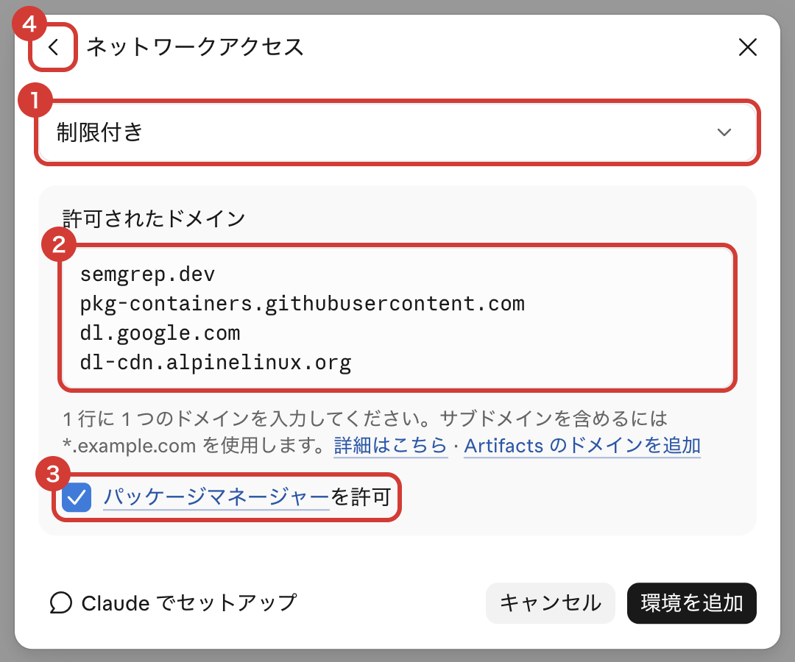

# 🌐 ネットワークアクセスを制限付きにする

[← README に戻る](../README.md)

README の手順では、Web の環境のネットワークアクセスを「フル」にします。通信先を絞りたいときは、代わりに次のように設定します。

環境の画面の「ネットワークアクセス」を押して、次のように設定します。

- ① 「制限付き」を選びます。
- ② 「許可されたドメイン」に、次の内容をコピーして貼り付けます。

  ```
  semgrep.dev
  pkg-containers.githubusercontent.com
  dl.google.com
  dl-cdn.alpinelinux.org
  ui.shadcn.com
  cdn.playwright.dev
  ```

- ③ 「[パッケージマネージャー](https://code.claude.com/docs/en/cloud-environments#default-allowed-domains)を許可」にチェックを入れます。
- ④ 「<」を押して、前の画面に戻ります。



リポジトリが使うほかのドメインが遮断されたら、「許可されたドメイン」に足します。`/autopilot:setup` は、遮断されたドメインを見つけると、足すよう頼みます。
