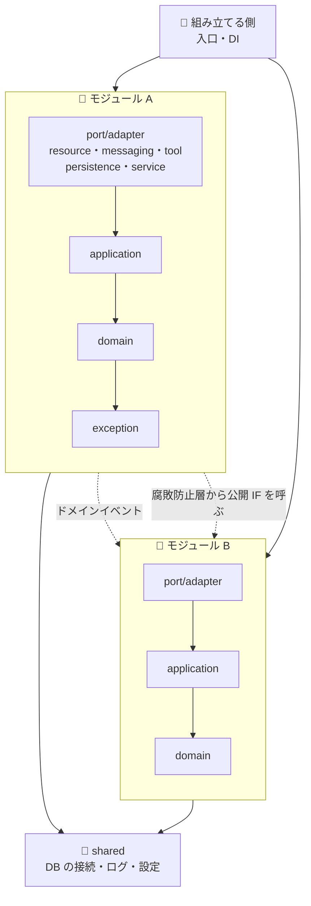
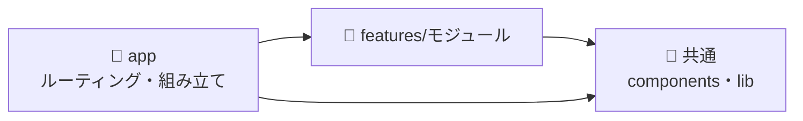

# 🏛️ architecture

すべての案件を、同じアーキテクチャで作るための標準です。どの案件も同じ場所に同じものがあるので、引き継ぎと保守が楽になります。

| 対象 | アーキテクチャ |
|---|---|
| バックエンド (Python・Go) | モジュラモノリス + ヘキサゴナル |
| フロントエンド (Next.js) | feature ベース |
| インフラ (GCP・AWS・Azure) | Terraform |

標準は、ツールで自動検査します。検査の設定は各リポジトリに置くため、プラグインが無くても CI で動きます。

## 🧩 バックエンド

業務のまとまりごとにモジュールを作り、1 つのアプリケーションにまとめます (モジュラモノリス)。モジュールの中は、ヘキサゴナルアーキテクチャの層に分けます。



### 層
上の層は下の層を import できます。下の層から上の層は import できません。要らない層は作りません。

| 層 | 置くもの |
|---|---|
| `core` | そのモジュールの DI 登録・ルーティング・購読者の宣言 |
| `middleware` | そのモジュールのリクエストの前後の処理 |
| `port/adapter` | 外とのやり取り。`resource` (API)・`messaging` (イベントの受信)・`tool` (MCP)・`persistence` (DB)・`service` (外部のサービス・腐敗防止層) |
| `application` | ユースケース (入力・出力の型と、アプリケーションサービス) |
| `domain` | エンティティ・値オブジェクト・リポジトリの IF・ドメインイベント |
| `exception` | エラーの種類 |

`domain` を import できるのは `core`・`application`・`port/adapter/persistence`・`port/adapter/service` だけです。受け付ける側 (`resource`・`messaging`・`tool`) は `application` を通します。

### モジュールの間
- モジュール同士は import しません。連携は、ドメインイベントか、腐敗防止層 (`port/adapter/service/<相手>/adapter/`) から相手の公開 IF (`port/adapter/resource`) を呼ぶ形だけにします
- 全モジュールが使う技術的なコードは `shared/` に置きます。`shared` からモジュールは import しません
- モジュールを組み立てる側 (入口と DI) は、モジュールの外に置きます

## 🖥️ フロントエンド

画面のコードは、バックエンドのモジュールと 1 対 1 の `src/features/<モジュール>/` に置きます。



- feature は別の feature を import しません。両方が要る画面は、app の page で組み立てます
- 共通のコードは features を import しません。features と共通のコードは app を import しません

## ☁️ インフラ

```
infrastructure/
├── modules/<役割>/         # 再利用する部品
└── environments/<環境>/    # 環境 (dev・stg・prod) ごとのルート。modules を呼んで組み立てる
```

- リソース名は `<project>-<env>-<role>`、Terraform の名前は snake_case にします
- すべてのリソースに `project`・`environment`・`managed_by` のラベル・タグを付けます
- state はクラウドのリモート (GCS・S3・Azure Storage) に置きます

## 🔍 検査

| 対象 | 何を | 道具 | 設定 | Claude Code | CI |
|---|---|---|---|---|---|
| Python | 依存の向き | import-linter | `pyproject.toml` | commit の前 (python) | `uv run lint-imports` |
| Go | 依存の向き | go test | `internal/architecture_test.go` | commit の前 (go) | `go test ./...` |
| Go | lint・整形 | golangci-lint・gofmt | `.golangci.yml` | 編集のあと・commit の前 (go) | `golangci-lint run ./...` |
| Next.js | 依存の向き | Biome | `biome.json`・`biome/` | 編集のあと (frontend) | `bunx biome check .`・`bash biome/features.test.sh` |
| Terraform | 書式・名前・ファイルの分け方 | terraform fmt・tflint | `infrastructure/.tflint.hcl` | 編集のあと・commit の前 (terraform) | `terraform fmt -check -recursive`・`tflint --recursive` |
| Terraform | セキュリティの設定 | Trivy | 無し | push の前 (security) | `trivy fs` |

検査の設定は、Claude Code で `/architecture:standard` を実行するとリポジトリに足せます。直していない違反は一時的に許し、新しい違反だけを止められます。

## 📚 言語ごとの書き方

- [Python](skills/standard/references/python.md)
- [Go](skills/standard/references/go.md)
- [Next.js](skills/standard/references/nextjs.md)
- [Terraform](skills/standard/references/terraform.md)

見本の実装: [theindiehacker/app.fastship.jp](https://github.com/theindiehacker/app.fastship.jp) (Python・Next.js)
