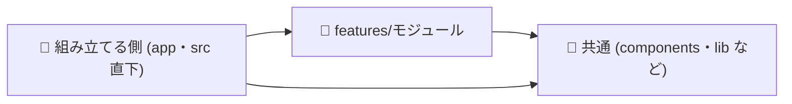

# Next.js の書き方

## ディレクトリ構成
画面のコードは、バックエンドのモジュールと 1 対 1 の `src/features/<モジュール>/` に置きます。
```
biome.json               # overrides に templates/nextjs/biome.overrides.json を足す
biome/                   # templates/nextjs/biome/ (feature.grit・features.test.sh)
src/
├── app/                 # App Router のルーティングだけ。page は features の部品を並べるだけにする (組み立てる側)
│   └── (<モジュール>)/  # モジュールのページ。route group なので URL には出ない
├── features/
│   └── <モジュール>/    # バックエンドのモジュールと同じ名前
│       ├── components/  # このモジュールの画面部品
│       ├── queries.ts   # 読み取り。Server Components から呼ぶ
│       ├── types.ts     # queries.ts と components の両方で使う型
│       └── actions.ts   # 更新。"use server" の Server Actions
├── components/          # 2 つ以上のモジュールで使う部品 (ui は shadcn/ui の生成物)
└── lib/                 # 共通の処理 (API クライアント・認証など)
e2e/<モジュール>/*.spec.ts # Playwright の E2E テスト
```
- feature の中は、要るものだけ作る
- `index.ts` (まとめて export するファイル) は作らず、ファイルを直接 import する
- 単体テスト (`*.test.ts`) は、確かめるファイルと同じディレクトリに置く

## 依存のルール

- feature は別の feature を import しない。両方が要る画面は、app の page で組み立てる
- 共通のコードは features を import しない
- features と共通のコードは、app を import しない
- app の外では `../` を使わず、`@/` から import する (lint はパスを解決できないため、`@/` の形で判定する)

## 部品の置き場所
上から順に見て、最初に当てはまったところに置きます。
1. `features/<モジュール>` の types・queries・actions を import する → `features/<モジュール>/components`
2. 使うのが 1 つのモジュールの画面だけ → `features/<モジュール>/components`
3. 2 つ以上のモジュール、または共通の部品から使う → `components/<役割>`。データは props で受け取る
4. 迷ったら features に置き、2 つ目の使う側ができたときに `components` に移す

## 検査
| 何を | 道具 | 設定 |
|---|---|---|
| feature 同士の import | Biome のプラグイン (GritQL) | `biome/feature.grit` |
| ほかの依存のルール | Biome の `noRestrictedImports` | `biome.json` の `overrides` |

- 前提: Biome 2.x、`src/` レイアウト、`tsconfig.json` の `@/*` → `./src/*`
- 入れ方: `templates/nextjs/biome.overrides.json` の `overrides` を `biome.json` に足し、`templates/nextjs/biome/` を `biome/` に写す
- CI: `bunx biome check .` と `bash biome/features.test.sh` (プラグインが壊れても biome check は黙って通るため、テストで確かめる)
- frontend プラグインは、編集したファイルを Biome で検査する

## feature を足す
`src/features/<モジュール>/`・`src/app/(<モジュール>)/`・`e2e/<モジュール>/` を作ります。設定は変えません。

## 移行中の違反
直していない違反は、その行の上に理由を書いて止め、直したら消します。
```ts
// biome-ignore lint/plugin: 移行中。直したら消す
import { x } from "@/features/other/actions";
// biome-ignore lint/style/noRestrictedImports: 移行中。直したら消す
import { y } from "../../lib/y";
```
