# 🎨 frontend

TypeScript・Next.js・shadcn/ui・Tailwind CSS・Playwright・Biome のフロントエンド開発で使うプラグインです。

## ⚙️ 自動で動くもの

| タイミング | 処理 | 動く条件 |
|---|---|---|
| 起動時 | `packageManager` の版の bun を用意し、`bun install --frozen-lockfile` | `bun.lock` がある |
| 起動時 | 技術スタックの方針を Claude に伝える | `package.json` がある |
| 編集後 | `biome check --write` | `biome.json` がある |
| commit 前 | `bun run typecheck` (無ければ `tsc --noEmit`) | `tsconfig.json` がある |

- **失敗時:** hook が exit 2 を返し、結果を Claude に渡します。commit 前の検査では commit も止まり、Claude が修正してやり直すと再び検査します。
- **検査の範囲:** 編集後は編集したファイルだけ、commit 前は `tsconfig.json` のあるフォルダごとに全体を検査します。
- **LSP:** Claude が TypeScript の LSP を使えます。

**Claude に伝える方針**

- パッケージの管理と実行は bun。npm・npx・yarn・pnpm は使わない
- lint と整形は Biome。ESLint・Prettier は使わない
- UI は shadcn/ui のコンポーネントを使う。無いものだけ、shadcn/ui を組み合わせて作る
- スタイルは Tailwind CSS のクラスとテーマの変数で書く。`style` 属性・色コード・Tailwind の任意値は書かない
- 画面を足す・変えるときは、Playwright で E2E テストを書く

## 🚀 技術スタックの移行

`/frontend:setup [フォルダ]` を実行すると、起動時の処理を動かして失敗を集め、リポジトリを調べ、足りない項目ごとに確認しながら移行します。

| 項目 | 内容 |
|---|---|
| bun | npm・yarn・pnpm から置き換える |
| Biome | ESLint・Prettier から置き換える |
| Tailwind CSS | 無ければ導入する |
| shadcn/ui | 無ければ導入する |
| Playwright | 無ければ導入し、トップページの E2E テストを 1 つ書く |
| 型チェック | `package.json` に `typecheck` を足す |

最後に `bun install --frozen-lockfile`・`bun run build`・`bunx biome check .`・`bun run typecheck`・`bun run test:e2e` が通ることを確かめます。PR を作るかを聞き、作ると答えたら PR を作ります。

## 🎁 一緒に入るプラグイン

  

