# 🛡️ security

commit と push の前に、シークレットと脆弱性を検査するプラグインです。

## ⚙️ 自動で動くもの

| タイミング | 処理 | 動く条件 |
|---|---|---|
| 起動時 | Gitleaks・Semgrep・Trivy を導入 | Web のみ。ローカルは無ければ警告だけ |
| commit 前 | `gitleaks dir` でシークレットを検出 | Gitleaks がある |
| push 前 | `semgrep scan --config p/owasp-top-ten --severity ERROR` | Semgrep がある |
| push 前 | `trivy fs --scanners vuln,misconfig,secret --severity HIGH,CRITICAL --ignore-unfixed` | Trivy がある |

- **失敗時:** hook が exit 2 を返し、commit・push を止めて結果を Claude に渡します。Claude が修正してやり直すと再び検査します。
- **検査の範囲:** 差分ではなくリポジトリ全体が対象です。Gitleaks と Trivy は、git に入るファイル (追跡中と、無視していない新規ファイル) だけを見ます。
- **ローカルでの準備:** Mac では `brew install semgrep gitleaks trivy` で入れられます。無いときや起動できないときは、起動時に警告が出るだけで、検査は素通りします。

## 🚀 既存の指摘を直す

検査はリポジトリ全体が対象なので、既存の指摘があると、関係のない変更でも commit・push が止まります。`/security:onboard` を実行すると、3 つの検査を動かし、指摘ごとに確認しながら直します。

| 指摘 | 直す | 除外する (誤検出・ダミーの値などで、ユーザーが選んだときだけ) |
|---|---|---|
| シークレット | コードから消し、ローテーションを頼む | `.gitleaksignore`・`.trivyignore.yaml` |
| Semgrep | コードを直す | `.semgrepignore` |
| Trivy | 依存を上げる・設定を直す | `.trivyignore.yaml` (`trivy.yaml` で読ませる。期限付き) |

除外には、1 件ごとに理由を書きます。最後に 3 つの検査が通ることを確かめ、PR を作るかを聞きます。

## 🎁 一緒に入るプラグイン

  

